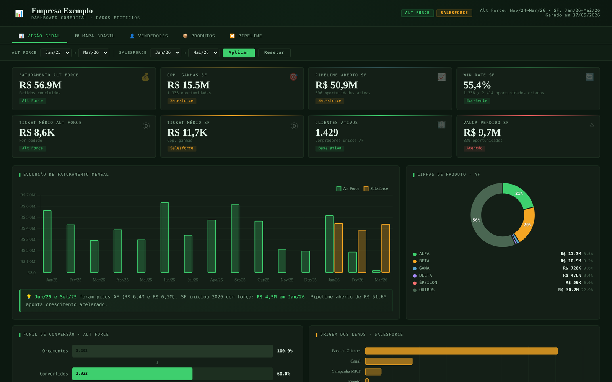
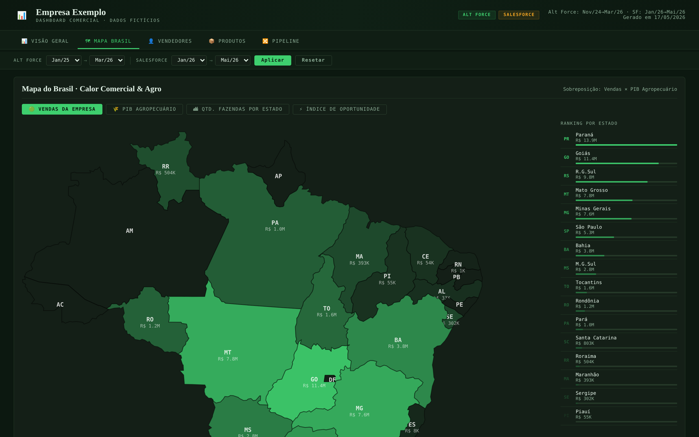
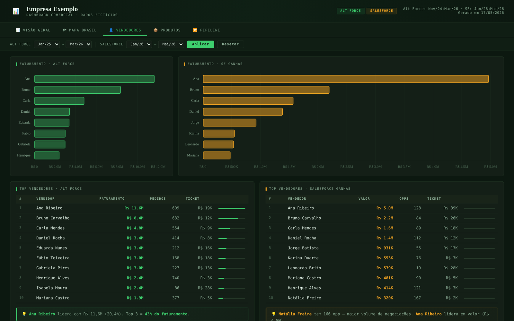
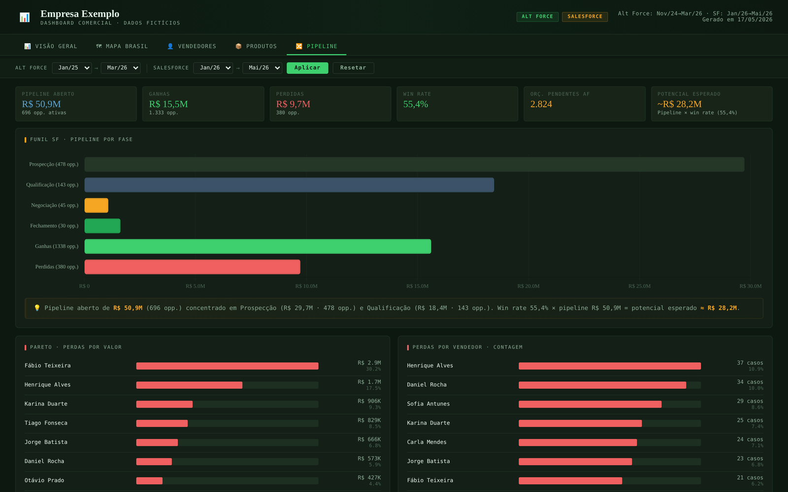

# Sales dashboard with a Brazil map

[🇧🇷 Português](README.md) | 🇺🇸 English

A sales dashboard in a single HTML file, with no server and no local dependencies, that combines sales from two systems (an order ERP and Salesforce) with public agribusiness data by state. Built as an example for an internal learning track.

> **The data is fictitious.** Sales rep names, products, cities and amounts were replaced or scaled; the public indicators (agricultural GDP and number of farms per state) come from IBGE, Brazil's statistics institute.

## The highlight: an embedded map of Brazil

- **State outlines embedded in the HTML itself** as SVG paths generated from IBGE's boundaries: the map opens straight from the file, with no `fetch`, no server and no CORS errors.
- **Four layers:** company sales, agricultural GDP, number of farms and an **opportunity index** that compares each state's agribusiness potential (average share of agricultural GDP and farms) with the company's share of sales.
- State ranking, tooltips with each source's numbers and the top 12 cities per system.

## Tabs

| Tab | What it shows |
|---|---|
| Overview | KPIs, monthly trend, product lines, conversion funnel and lead sources |
| Brazil map | Sales × agribusiness heat by state and the opportunity index |
| Sales reps | Ranking by revenue, average ticket and pipeline per rep |
| Products | Revenue by line, top products and payment methods |
| Pipeline | Funnel by stage and Pareto of losses by value, rep and reason |

Independent date filters for each system, animated KPIs and an insight note under each chart.

## How to use

Download `index.html` and open it in a browser. Chart.js loads from a CDN.

## Tech stack

HTML · CSS · JavaScript · Chart.js 4 · SVG · IBGE public data

## Author

João Victor Guidi de Lima · [LinkedIn](https://www.linkedin.com/in/joão-lima-8b512) · [GitHub](https://github.com/Joao-2003)
