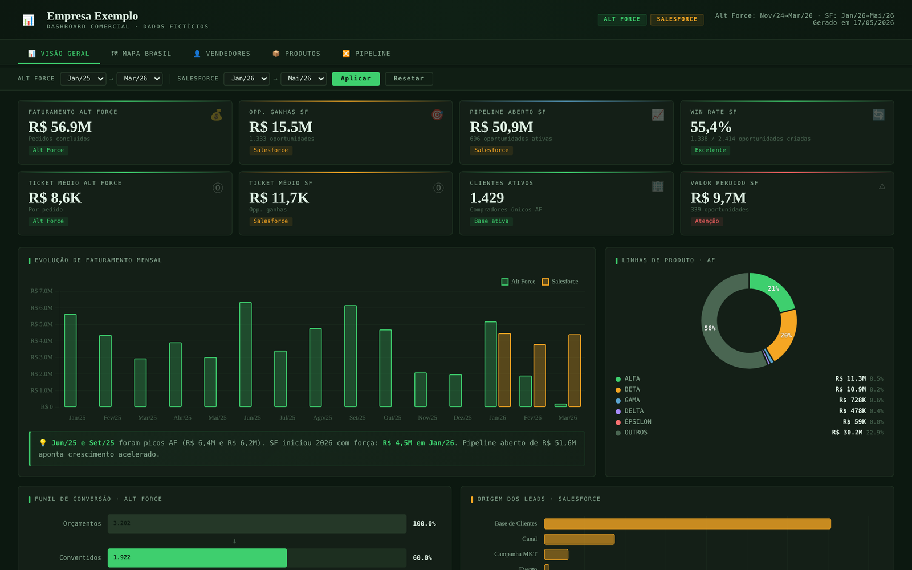
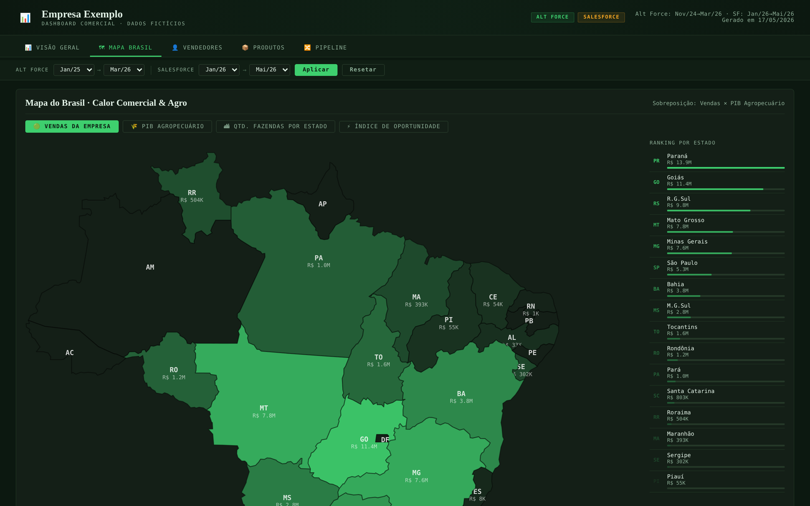
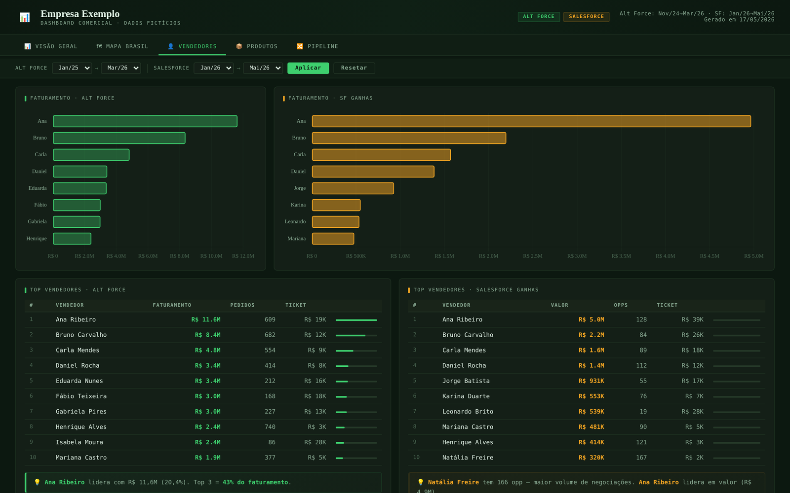
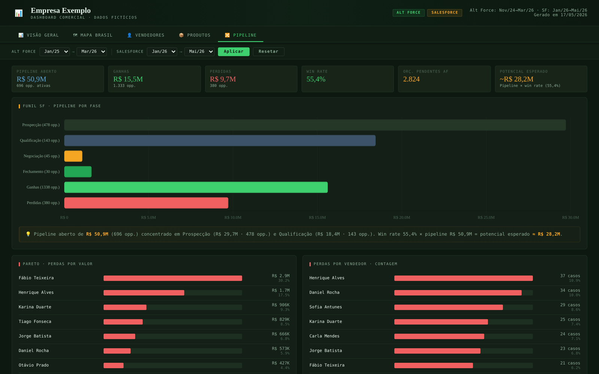

# Dashboard comercial com mapa do Brasil

🇧🇷 Português | [🇺🇸 English](README.en.md)

Dashboard comercial em um único arquivo HTML, sem servidor e sem dependências locais, que cruza vendas de dois sistemas (ERP de pedidos e Salesforce) com dados públicos do agro por estado. Feito como exemplo para uma trilha de conhecimento interna.

> **Os dados são fictícios.** Nomes de vendedores, produtos, cidades e valores foram substituídos ou escalados; os indicadores públicos (PIB agropecuário e número de fazendas por estado) são do IBGE.

## O diferencial: mapa do Brasil embutido

- **Contornos dos estados embutidos no próprio HTML** como caminhos SVG, gerados a partir da malha do IBGE: o mapa abre direto do arquivo, sem `fetch`, sem servidor e sem erro de CORS.
- **Quatro camadas:** vendas da empresa, PIB agropecuário, quantidade de fazendas e um **índice de oportunidade**, que compara o potencial agro de cada estado (média das participações em PIB agro e em fazendas) com a participação da empresa nas vendas.
- Ranking por estado, tooltip com os números de cada fonte e top 12 cidades por sistema.

## Abas

| Aba | O que mostra |
|---|---|
| Visão geral | KPIs, evolução mensal, linhas de produto, funil de conversão e origem dos leads |
| Mapa Brasil | Calor comercial × agro por estado e índice de oportunidade |
| Vendedores | Ranking por faturamento, ticket médio e pipeline por vendedor |
| Produtos | Faturamento por linha, top produtos e métodos de pagamento |
| Pipeline | Funil por fase, Pareto de perdas por valor, por vendedor e por motivo |

Filtros de período independentes para cada sistema, com animação dos KPIs e textos de insight em cada gráfico.

## Como usar

Baixe o `index.html` e abra no navegador. O Chart.js vem de CDN.

## Tecnologias

HTML · CSS · JavaScript · Chart.js 4 · SVG · dados públicos do IBGE

## Autor

João Victor Guidi de Lima · [LinkedIn](https://www.linkedin.com/in/joão-lima-8b512) · [GitHub](https://github.com/Joao-2003)
